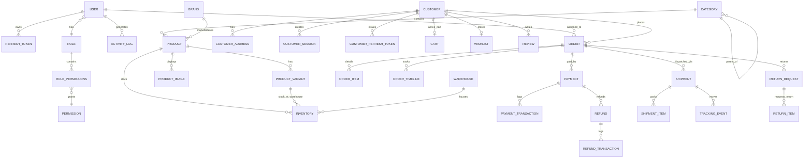

# Database Architecture & Data Modeling Specification

## 1. Relational Database Overview

The platform uses **PostgreSQL 15+** managed exclusively through **Prisma ORM (v5.22.0)**. The schema definition resides at `prisma/schema.prisma` (1,621 lines) and comprises **53 models**, **13 enums**, and **91 indexes**.

Database connection pooling and lifecycle are managed through a singleton `PrismaClient` exported from `src/backend/config/db.ts` with real-time query event logging configured for development inspection.

---

## 2. Domain Data Models Catalog

The database models are divided into eight primary business domains:

```
+--------------------------------------------------------------------------------------------------+
|                                    VELMORA DATA DOMAINS                                          |
+--------------------------------------------------------------------------------------------------+
| 1. IAM & Security       | User, RefreshToken, Role, Permission, ActivityLog                      |
| 2. Customer & Identity  | Customer, CustomerNote, CustomerAddress, CustomerSession,               |
|                         | CustomerRefreshToken, CustomerOtp, CustomerActivity                    |
| 3. Product Catalog      | Vendor, Warehouse, Category, CategoryImage, Brand, BrandImage, Tag,     |
|                         | ProductTag, Attribute, AttributeValue, Product, ProductVariant,         |
|                         | VariantAttributeValue, ProductImage, Inventory                          |
| 4. Orders & Fulfillment | Order, OrderItem, OrderTimeline, OrderNote, Courier, Shipment,          |
|                         | ShipmentItem, TrackingEvent, ReturnRequest, ReturnItem                  |
| 5. Financials & Payments| Payment, PaymentTransaction, PaymentWebhookLog, Refund,                 |
|                         | RefundTransaction                                                       |
| 6. Cart & Checkout      | Cart, CartItem, Wishlist, WishlistItem, AbandonedCart                   |
| 7. Marketing & Content  | Coupon, Promotion, MarketingCampaign, Banner, Popup, Review,            |
|                         | ReviewImage, Page, PageVersion, LandingPage, BlogPost, BlogCategory,     |
|                         | BlogTag, SeoMetadata, GlobalSeoSettings, MediaAsset, FAQCategory, FAQ,  |
|                         | ProductFaq, UploadTracker                                               |
| 8. System & Settings    | Notification, NotificationPreference, AnalyticsEvent, Setting,          |
|                         | BrandingSetting, SEOSetting, SMTPSetting, AnalyticsSetting,             |
|                         | SecuritySetting, ShippingSetting, TaxSetting, StoreSetting              |
+--------------------------------------------------------------------------------------------------+
```

---

## 3. Database Enumerations (Enums)

| Enum Name | Defined Values | Usage Domain |
| :--- | :--- | :--- |
| `AuthProvider` | `LOCAL`, `GOOGLE`, `FACEBOOK` | Customer OAuth & identity |
| `ReviewStatus` | `PENDING`, `APPROVED`, `REJECTED`, `HIDDEN` | Product review moderation |
| `PaymentStatus` | `PENDING`, `PROCESSING`, `PAID`, `FAILED`, `CANCELLED`, `REFUNDED` | Financial payment transactions |
| `PaymentProvider`| `COD`, `BKASH`, `NAGAD`, `SSLCOMMERZ`, `STRIPE` | Multi-gateway payment routing |
| `RefundStatus` | `PENDING`, `PROCESSING`, `COMPLETED`, `FAILED`, `REJECTED` | Financial refund lifecycle |
| `ShipmentStatus` | `PENDING`, `PROCESSING`, `PACKED`, `SHIPPED`, `IN_TRANSIT`, `OUT_FOR_DELIVERY`, `DELIVERED`, `FAILED_DELIVERY`, `RETURNED`, `CANCELLED` | Carrier fulfillment states |
| `TrackingStatus` | `INFO_RECEIVED`, `IN_TRANSIT`, `OUT_FOR_DELIVERY`, `DELIVERED`, `EXCEPTION` | Carrier tracking timeline |
| `ReturnStatus` | `REQUESTED`, `APPROVED`, `REJECTED`, `RECEIVED`, `REFUND_PENDING`, `REFUNDED`, `CLOSED` | RMA returns workflow |
| `NotificationType`| `ORDER_CREATED`, `PAYMENT_SUCCESS`, `PAYMENT_FAILED`, `ORDER_SHIPPED`, `OUT_FOR_DELIVERY`, `ORDER_DELIVERED`, `RETURN_REQUESTED`, `RETURN_APPROVED`, `REFUND_COMPLETED`, `ACCOUNT_SECURITY`, `GENERAL` | Customer & system alerts |
| `NotificationChannel`| `EMAIL`, `SMS`, `IN_APP` | Multi-channel dispatch routing |
| `NotificationStatus`| `PENDING`, `SENT`, `FAILED`, `READ` | Dispatch status tracking |
| `ActivityType` | `REGISTER`, `LOGIN`, `LOGOUT`, `PROFILE_UPDATED`, `ADDRESS_CREATED`, `ADDRESS_UPDATED`, `WISHLIST_ADD`, `WISHLIST_REMOVE`, `CART_ADD`, `CART_UPDATE`, `CART_REMOVE`, `CHECKOUT_STARTED`, `ORDER_CREATED`, `PAYMENT_INITIATED`, `PAYMENT_COMPLETED`, `ORDER_SHIPPED`, `ORDER_DELIVERED`, `RETURN_REQUESTED`, `REFUND_COMPLETED` | Customer behavior tracking |
| `OtpPurpose` | `REGISTRATION`, `LOGIN`, `CHANGE_MOBILE`, `ACCOUNT_RECOVERY` | SMS OTP verification states |

---

## 4. Detailed Models & Entity Relationships

### 4.1 IAM & Access Control
- `User` ──(N:1)──> `Role` ──(N:M via RolePermissions)──> `Permission`
- `User` ──(1:N)──> `RefreshToken` (onDelete: Cascade)
- `User` ──(1:N)──> `ActivityLog`
- `User` ──(1:N as "AssignedOrders")──> `Order`
- Unique Constraints: `User.email`, `Role.name`, `Permission.name`, `Permission(module, action)`.

### 4.2 Customer & Identity
- `Customer` ──(1:N)──> `CustomerAddress` (onDelete: Cascade)
- `Customer` ──(1:N)──> `CustomerSession` (onDelete: Cascade)
- `Customer` ──(1:N)──> `CustomerRefreshToken` (onDelete: Cascade)
- `Customer` ──(1:1)──> `Cart` (onDelete: Cascade)
- `Customer` ──(1:1)──> `Wishlist` (onDelete: Cascade)
- `Customer` ──(1:1)──> `NotificationPreference` (onDelete: Cascade)
- `Customer` ──(1:N)──> `CustomerNote` (onDelete: Cascade)
- `Customer` ──(1:N)──> `CustomerActivity` (onDelete: Cascade)
- `Customer` ──(1:N)──> `Notification` (onDelete: Cascade)
- `Customer` ──(1:N)──> `Order`, `Payment`, `Refund`, `ReturnRequest`, `Review`

### 4.3 Catalog & Inventory
- `Category` ──(N:1 self-reference as "CategoryHierarchy")──> `Category` (parentId)
- `Category` ──(1:N)──> `CategoryImage` (onDelete: Cascade)
- `Category` ──(1:N)──> `Product`
- `Brand` ──(1:N)──> `BrandImage` (onDelete: Cascade)
- `Brand` ──(1:N)──> `Product`
- `Product` ──(1:N)──> `ProductVariant` (onDelete: Cascade)
- `Product` ──(1:N)──> `ProductImage` (onDelete: Cascade)
- `Product` ──(1:N)──> `ProductTag` ──(N:1)──> `Tag` (onDelete: Cascade, composite key `[productId, tagId]`)
- `Attribute` ──(1:N)──> `AttributeValue` (onDelete: Cascade)
- `ProductVariant` ──(1:N)──> `VariantAttributeValue` ──(N:1)──> `AttributeValue` (composite key `[variantId, attributeValueId]`)
- `Inventory` connects either directly to single-variant `Product` (1:1) or to multi-variant `ProductVariant` (N:1) partitioned by `Warehouse` (N:1).
  - Unique Constraint: `@@unique([warehouseId, variantId])`.

### 4.4 Orders & Fulfillment (OMS)
- `Order` ──(1:N)──> `OrderItem` (onDelete: Cascade)
- `OrderItem` ──(N:1)──> `Product`
- `OrderItem` ──(N:1)──> `ProductVariant` (onDelete: SetNull)
- `OrderItem` ──(N:1)──> `Warehouse` (fulfillment origin, onDelete: SetNull)
- `Order` ──(1:N)──> `OrderTimeline` (onDelete: Cascade)
- `Order` ──(1:N)──> `OrderNote` (onDelete: Cascade)
- `Order` ──(1:N)──> `Shipment` (onDelete: Cascade)
- `Shipment` ──(1:N)──> `ShipmentItem` ──(N:1)──> `OrderItem`
- `Shipment` ──(1:N)──> `TrackingEvent` (onDelete: Cascade)
- `Order` ──(1:N)──> `ReturnRequest` (onDelete: Cascade)
- `ReturnRequest` ──(1:N)──> `ReturnItem` ──(N:1)──> `OrderItem`
- `ReturnItem` ──(N:1)──> `Warehouse` (restock target, onDelete: SetNull)

### 4.5 Financials & Payments
- `Order` ──(1:N)──> `Payment` (onDelete: Cascade)
- `Payment` ──(1:N)──> `PaymentTransaction` (onDelete: Cascade)
- `Payment` ──(1:N)──> `Refund` (onDelete: Cascade)
- `Refund` ──(1:N)──> `RefundTransaction` (onDelete: Cascade)
- `PaymentWebhookLog`: Independent ledger with `@@unique([provider, eventId])` ensuring strict webhook idempotency.

---

## 5. Relational ER Diagram



---

## 6. Concurrency Control & Row-Level Locking

In high-concurrency eCommerce platforms, race conditions during checkout, payment confirmations, and refunds can lead to overselling or duplicate refunds. This codebase addresses these issues using **PostgreSQL Pessimistic Row-Level Locking (`FOR UPDATE`)** inside interactive transactions (`prisma.$transaction`):

1. **Order Cancellation & Payment State (`src/backend/controllers/order.controller.ts:238`)**:
   ```sql
   SELECT id FROM "Payment" WHERE id = ${payment.id} FOR UPDATE;
   ```
   Locks the authoritative payment row before checking refundable amounts and creating refund entries.
2. **Refund Initiation & Approval (`src/backend/services/refund.service.ts:139, 146, 213, 222, 359`)**:
   ```sql
   SELECT id FROM "Payment" WHERE id = ${targetRefund.paymentId} FOR UPDATE;
   SELECT id FROM "Refund" WHERE id = ${refundId} FOR UPDATE;
   ```
   Locks both `Payment` and `Refund` rows to guarantee idempotent refund execution.
3. **Checkout Coupon Verification (`src/backend/services/storefront/checkout.service.ts:624`)**:
   ```sql
   SELECT id FROM "Coupon" WHERE id = ${cart.couponId} FOR UPDATE;
   ```
   Prevents coupon over-usage beyond `usageLimit` by locking the coupon row during checkout finalization.
4. **Payment Gateway Webhook Verification (`src/backend/services/storefront/paymentSecurity.service.ts:415`)**:
   ```sql
   SELECT id FROM "Payment" WHERE id = ${paymentId} FOR UPDATE;
   ```
   Prevents concurrent duplicate webhook executions from marking an order paid multiple times.

---

## 7. Migrations & Seeding Analysis

### 7.1 Database Migrations
Located in `prisma/migrations/`:
- `20260820000000_add_pending_email`: Adds `pendingEmail`, `pendingEmailVerificationToken`, and `pendingEmailVerificationExpires` to `Customer` for secure email modification.
- `20260821000000_add_return_item_warehouse_id`: Adds `warehouseId` foreign key to `ReturnItem` to allow direct restock tracking into the originating fulfillment warehouse.

### 7.2 Database Seeder (`prisma/seed.ts`)
- Seeds **31 permission modules**: `Dashboard`, `Products`, `Categories`, `Brands`, `Inventory`, `Analytics`, `Attributes`, `Users`, `Roles`, `Permissions`, `Settings`, `Security`, `Orders`, `Customers`, `Coupons`, `Promotions`, `Marketing`, `Banners`, `Popups`, `Sessions`, `AuditLogs`, `Media`, `Blog`, `CMS`, `LandingPages`, `FAQ`, `SEO`, `Payments`, `Refunds`, `Returns`, `Shipments`, `Notifications`.
- Generates **93 granular permissions** (`read_<mod>`, `write_<mod>`, `delete_<mod>`).
- Provisions **6 predefined roles**: `SuperAdmin`, `Admin`, `InventoryManager`, `MarketingManager`, `SupportAgent`, `Viewer`.
- Seeds initial SuperAdmin user from `ADMIN_EMAIL` and `ADMIN_PASSWORD`.
- Seeds default catalog entities (Electronics category, Pro Wireless Headphones, Ergonomic Keyboard).
- Seeds 3 demo customers with verified orders (`ORD-1001`, `ORD-1002`, `ORD-1003`).
- Seeds default site branding, global SEO, shipping rates, and tax rules.

---

## 8. Identified Data Integrity & Performance Risks

### 8.1 Critical Runtime Query Bug in Inventory Controller
- **Location**: `src/backend/controllers/inventory.controller.ts:9`
- **Code**:
  ```typescript
  where: {
    quantityAvailable: {
      lte: prisma.inventory.fields.lowStockThreshold // INVALID PRISMA SYNTAX
    }
  }
  ```
- **Impact**: In Prisma Client v5, `prisma.<model>.fields` is not a valid query expression for column-to-column comparison. Invoking `GET /api/v1/inventory/low-stock` results in an unhandled runtime error (`TypeError: Cannot read properties of undefined (reading 'lowStockThreshold')`).
- **Remediation**: Use a raw SQL query (`SELECT * FROM "Inventory" WHERE "quantityAvailable" <= "lowStockThreshold"`) or load and filter in memory as implemented in `DashboardService.getInventoryAlerts`.

### 8.2 Missing Indexes on High-Traffic Foreign Keys
- `CartItem.cartId`, `CartItem.productId`, `CartItem.variantId` are indexed, but composite `@@unique([cartId, productId, variantId])` is missing, allowing duplicate cart line items instead of quantity increments if not guarded by application logic.
- `ShipmentItem.productImageId` and `ReturnItem.productImageId` are indexed, but `Shipment.idempotencyKey` lacks a compound index with `provider`.

### 8.3 Historical Fulfillment Warehouse Ambiguity
- When cancelling an order placed prior to warehouse tracking (`OrderItem.warehouseId === null`), `order.controller.ts:354` throws `INVENTORY_WAREHOUSE_ORIGIN_UNKNOWN` if the product exists in multiple warehouses, blocking admin order cancellation without providing a resolution path.
